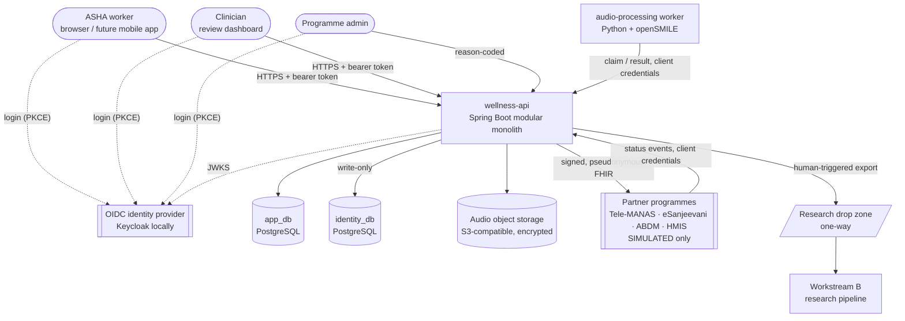
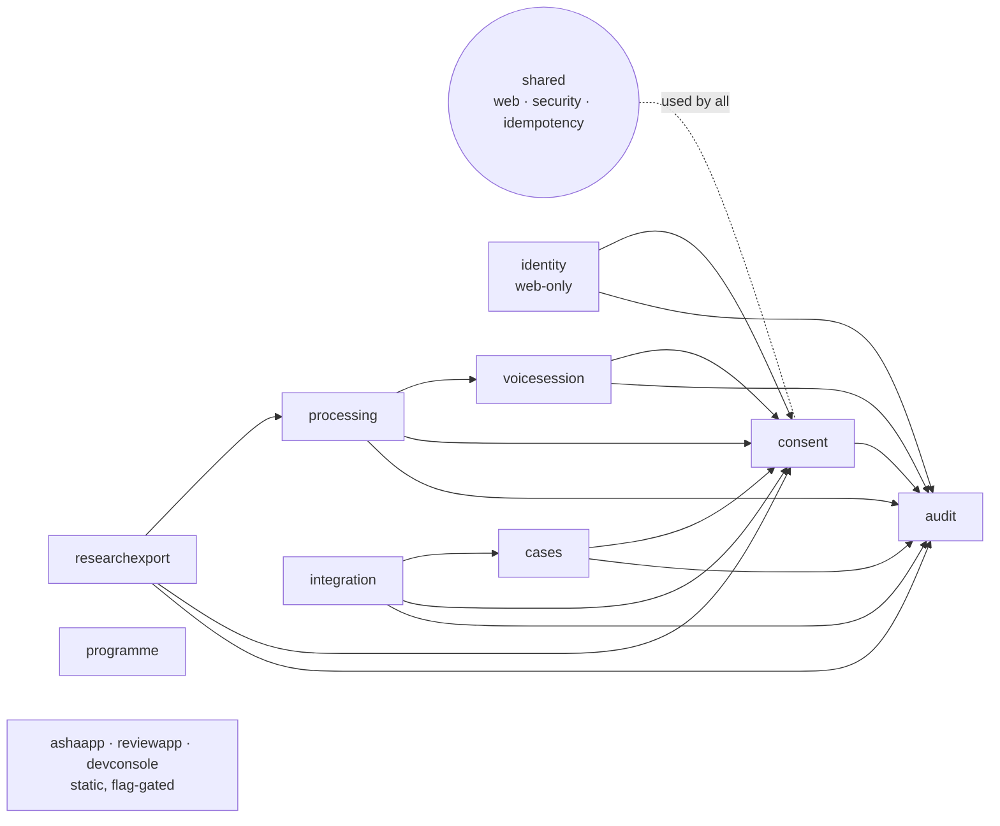
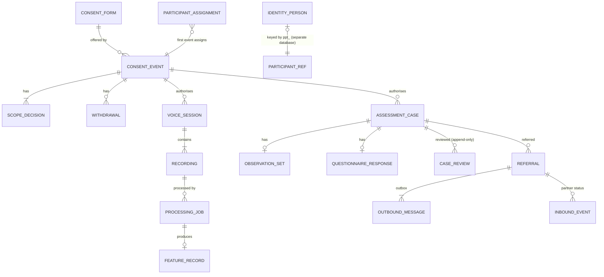
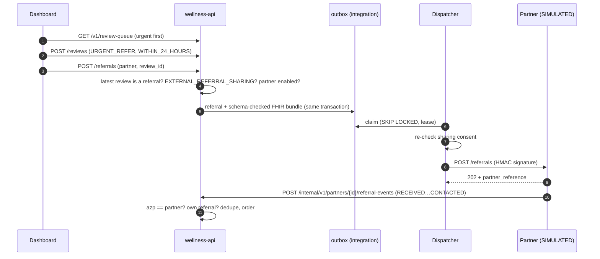

# Design and Architecture — As Built

| | |
|---|---|
| **Version** | 1.0 |
| **Date** | 2026-10-20 |
| **Describes** | `main` at commit 38bc30b |
| **Audience** | Engineers, architects, security and privacy reviewers |
| **Related** | [Business requirements](../business/business-requirements.md) · [Production infrastructure](../deployment/production-infrastructure-and-deployment.md) · [Solution architecture (original design)](solution-architecture.md) · [ADR log](architecture-decisions.md) · [Contracts](../../contracts/) |

This document describes the system **as it is implemented**. [solution-architecture.md](solution-architecture.md) holds the original target design. Where the two differ, this document reflects the code, and the ADR log explains why.

---

## 1. Architectural goals and principles

| Goal | How the design meets it |
|---|---|
| **Privacy by construction** | Identity lives in its own database and module, is write-only and field-encrypted. All other data is pseudonymous and coded. The research side never sees audio or identity (ADR-006, ADR-010, ADR-013). |
| **Consent enforced in code** | Every write that touches participant data calls `ConsentGate` on the record's own consent event. Withdrawal cascades through `WithdrawalAction` hooks (ADR-011). |
| **No automated clinical claims** | No score, prediction or diagnosis is computed or exposed. Contract tests forbid such fields (ADR-012). |
| **Humans trigger consequential actions** | Research export, HMIS report and partner referral are each an explicit human action; there's no automatic retraining or deployment (CLAUDE.md rules 5 and 6). |
| **No fabricated integrations** | Partners are SIMULATED. REAL mode refuses to start without an agreement and approval (ADR-015, rule 7). |
| **Offline tolerance** | Client-generated IDs plus `Idempotency-Key` on every create make retries safe (ADR-008). |
| **Simple to operate** | A modular monolith, one stateless worker, PostgreSQL as the job queue and outbox. No broker, mesh or Kubernetes is required (ADR-004, ADR-007). |
| **Contract first** | Versioned OpenAPI 3.1 and JSON Schema contracts. Real test traffic is validated against them in CI (ADR-009). |

## 2. System context



**Trust boundaries**
1. Internet ↔ API (TLS, OIDC).
2. API ↔ data stores (private network, separate credentials per database).
3. API ↔ worker: the worker has **no** database or storage credentials and gets audio only through a leased internal API.
4. Application ↔ research: a one-way drop zone, re-keyed IDs, no network route back.
5. Application ↔ partners: outbound signed messages and inbound authenticated events; the `azp` claim must match the partner.

## 3. Containers (deployable units)

| Unit | Technology | Responsibility | State |
|---|---|---|---|
| `wellness-api` | Java 21, Spring Boot 4.1, Spring Modulith 2.1, JdbcClient, Flyway, Spring Security 7 (OAuth2 resource server) | All public and internal APIs, business rules, consent, audit, outbox dispatch, schedulers. Optionally serves three static web apps (off by default). | Stateless |
| `audio-processing-worker` | Python 3.12, openSMILE 3.x (eGeMAPSv02 functionals) | Claims jobs, downloads leased audio, runs quality control and extraction, returns a feature record | Stateless |
| Static web apps (`/asha/`, `/review/`, `/dev-console/`) | Plain HTML/CSS/JS, no framework | Field app, clinician dashboard, technical console. **Local test builds**: each refuses to start where PARTICIPANT data is allowed. | Browser memory only |
| `app_db` | PostgreSQL 16 | Everything except identity | Durable |
| `identity_db` | PostgreSQL 16 (separate database and role) | `identity.person`: ciphertext only | Durable |
| Audio storage | S3 API (SeaweedFS locally) | Raw recordings under random keys | Durable, expiring |
| Research pipeline | Python 3.9+ | Verifies and ingests exports into its own store; applies withdrawals | Separate environment |
| Partner simulator | Python (stdlib) | Local stand-in for partner endpoints | Local only |

## 4. Module design (`wellness-api`)

Modules are Spring Modulith application modules. A module's root package is its public API and `internal` is private; `ModularityTests` verifies the boundaries and `ArchitectureTests` adds project rules.



| Module | Public API (root package) | Owns (schema) | Key rules |
|---|---|---|---|
| `shared` | `CorrelationId`, `ProblemCode`, `DomainException`, `Actor`, `Pseudonyms`, `IdempotencyService`, `LanguageTags` | `idempotency` | RFC 9457 problems that never echo values; idempotency keys scoped to caller and operation |
| `audit` | `AuditLog`, `AuditEvent` | `audit` | Append-only (enforced by triggers); field regexes reject free text |
| `consent` | `ConsentGate`, `ParticipantAccess`, `ConsentScope`, `WithdrawalAction` | `consent` | Checks run on the referenced event; first consent assigns the participant to the worker; cascading withdrawal |
| `identity` | none (no other module may depend on it) | `identity_db.identity` | Own connection pool and Flyway; AES-256-GCM with participant+field as associated data; no read path; web application only |
| `voicesession` | `RecordingAudio`, `StoredRecording` | `voice` | Consent re-checked at session, registration and upload; checksum and magic-byte checks; deferred audio deletion |
| `processing` | `FeatureRecords` | `processing` | Job queue with leases (`SKIP LOCKED`, at most 3 attempts); worker-supplied context overwritten from server records; feature-record schema validation |
| `researchexport` | none | `research_export` | HMAC re-keying, date truncation, exclusions, withdrawal announcements; run-once process |
| `cases` | `ReviewedCases`, `ReferralBasis`, `CaseStatistics` | `cases` | Coded answers only; never scored; urgent flag rule; append-only reviews; review eligibility includes consent |
| `integration` | none | `integration` | Partner registry guardrails, outbox and dispatcher, signed delivery, inbound events, revocation, HMIS report |
| `programme` | none | none (configuration) | Support contacts, labelled unverified until verified |
| `ashaapp` / `reviewapp` / `devconsole` | none | none | Static files behind a flag, with strict CSP and `no-store` |

## 5. Data architecture

### 5.1 Stores and separation
- **`app_db`** (role `app_user`) holds the schemas `consent`, `voice`, `processing`, `research_export`, `audit`, `idempotency`, `cases` and `integration`.
- **`identity_db`** (role `identity_user`) holds the `identity` schema. Neither role can connect to the other database (`verify.sh` checks this).
- **Object storage** holds audio only, at keys `audio/rec_<random>`. Server-side encryption is the default, and a lifecycle rule expires objects.

### 5.2 Entities



| Schema | Tables | Migration | Notes |
|---|---|---|---|
| `audit` | `audit_event` | V1 | Triggers reject UPDATE, DELETE and TRUNCATE |
| `idempotency` | `request_key` | V2 | Request hash plus stored response for replay |
| `consent` | `consent_form`, `participant_assignment`, `consent_event`, `scope_decision`, `withdrawal`, `withdrawn_scope` | V3, V7, V9 | `consent.scope` is a PostgreSQL enum of 7 values |
| `voice` | `session`, `recording` | V4 | Language limited to en-IN/kn-IN (the feature schema's set) |
| `processing` | `job`, `feature_record` | V5 | Feature record stored as validated JSON |
| `research_export` | `export`, `exported_record`, `announced_withdrawal` | V6 | |
| `cases` | `assessment_case`, `observation_set`, `observation`, `questionnaire_response`, `questionnaire_answer`, `case_review` | V7, V8 | No name, place, free-text or score columns (checked by test) |
| `integration` | `referral`, `outbound_message`, `inbound_event` | V10, V11 | Partial unique index: one live referral per case and partner |
| `identity` (identity_db) | `person` | identity V1 | `display_name_enc` and `village_name_enc` are AES-GCM ciphertext |

### 5.3 Identifiers
Every ID is client- or server-generated random hex with a type prefix: `ppt_` participant, `ce_` consent event, `cw_` withdrawal, `sess_` voice session, `rec_` recording, `job_` processing job, `frec_` feature record, `case_`, `obs_` observation set, `qr_` questionnaire response, `rvw_` review, `ref_` referral, `msg_` outbound message, `hmis_` report. Derived pseudonyms are HMAC-SHA-256 under `WELLNESS_PSEUDONYM_KEY`:
- `wkr_` for workers
- `clin_` for clinicians
- `pk_` for a participant as seen by one partner

Research exports re-key IDs under the separate `WELLNESS_EXPORT_KEY`.

## 6. Interfaces

| Contract | Version | Consumers | Operations |
|---|---|---|---|
| [`wellness-api.v1.yaml`](../../contracts/openapi/wellness-api.v1.yaml) | 1.3.0-draft | Field app, dashboard, mobile app (future) | Consent (4), voice (4), processing (2), cases (6), review (3), programme (1), referrals (3) |
| [`identity-api.v1.yaml`](../../contracts/openapi/identity-api.v1.yaml) | 1.0.0-draft | Field app | `PUT /v1/participants/{ref}/identity`, write-only, returns 204 |
| [`processing-worker.internal.v1.yaml`](../../contracts/openapi/processing-worker.internal.v1.yaml) | 1.0.0-draft | Worker | claim, audio, result, failure |
| [`integration-internal.v1.yaml`](../../contracts/openapi/integration-internal.v1.yaml) | 1.0.0-draft | Partner systems | `POST /internal/v1/partners/{id}/referral-events` |
| [`feature-record.schema.json`](../../contracts/voice-features/feature-record.schema.json) | 2.0.0 | Worker, research | Acoustic feature record |
| [`export-manifest.schema.json`](../../contracts/research-export/export-manifest.schema.json) | 1.0.0 | Research | Export batch manifest |
| [`referral-bundle.schema.json`](../../contracts/integration/referral-bundle.schema.json) | 1.0.0 | Partners | Pseudonymous FHIR R4 Bundle |
| [`hmis-aggregate-report.schema.json`](../../contracts/integration/hmis-aggregate-report.schema.json) | 1.0.0 | HMIS | Monthly counts, `<5` suppression |
| [`wellness-api-provisional.v0.yaml`](../../contracts/openapi/wellness-api-provisional.v0.yaml) | 0.1.0 | none | Care-pathway referrals and follow-ups, **not implemented** |

**Cross-cutting rules applied to every operation:**
- Bearer token always required.
- `X-Correlation-ID` is echoed back.
- `Idempotency-Key` is required on every POST create.
- Errors are RFC 9457 problems (a closed set of codes; never values, stack traces or hostnames).
- Unknown JSON fields are rejected.
- ADMIN access needs an `X-Access-Reason`.

## 7. Key flows

### 7.1 Saving a visit (field app → API)

```mermaid
sequenceDiagram
  autonumber
  participant App as Field app
  participant API as wellness-api
  participant C as consent
  participant K as cases
  participant I as identity
  App->>API: POST /v1/consent-events (form 0.2.0, decisions)
  API->>C: validate decisions vs form, assign participant
  App->>API: POST /v1/cases (age band, gender, SYNTHETIC)
  API->>C: ConsentGate.require(SCREENING_PARTICIPATION)
  App->>API: PUT /v1/participants/{ppt}/identity (name, village)
  API->>C: require(SCREENING_PARTICIPATION)
  API->>I: AES-GCM encrypt → identity_db (upsert)
  App->>API: POST observations / questionnaire-responses
  API->>K: validate codes; urgent flag if SELF_HARM ∈ {SOMETIMES, OFTEN}
  App->>API: POST /completion (follow-up decision)
  Note over App,API: Each call carries a fixed Idempotency-Key, so an offline replay is safe.
```

### 7.2 Review and partner referral



### 7.3 Voice processing
1. The worker calls `claim` and gets a job plus a lease token.
2. It downloads the leased audio, then runs quality control: clipping, level, duration, noise, speech ratio, silence.
3. It runs openSMILE (eGeMAPSv02 functionals) and posts the feature record to `result`.
4. The API overwrites the language, consent reference and provenance from its own records, then validates the record against schema v2.0.0.
5. If the lease expires, the job returns to the queue (at most 3 attempts).

### 7.4 Withdrawal
`POST /withdrawals` cascades the requested scopes to their dependents and records the withdrawal append-only. It then calls each module's `WithdrawalAction` in the same transaction:

| Action | Effect |
|---|---|
| `CANCEL_QUEUED_PROCESSING` | Queued audio jobs are cancelled |
| `DELETE_RETAINED_AUDIO` | Audio is deleted, with a deferred sweep if storage is down |
| `FLAG_DERIVED_FEATURES` | Feature records are flagged |
| `EXCLUDE_FROM_RESEARCH_EXPORT` | Future exports leave the person out |
| `REVOKE_EXTERNAL_REFERRAL` | Pending messages are cancelled; a revocation is queued wherever a referral was delivered or was in flight |

Every check that runs later also re-reads consent, so nothing proceeds on a withdrawn scope:
- review eligibility
- dispatch
- research export

## 8. Security design

| Concern | Design |
|---|---|
| **Authentication** | OIDC JWT (RS256 only). Issuer and audience are validated; HS256 and unsigned tokens are rejected (tested). Users log in with PKCE; services use client credentials. |
| **Authorisation** | Method-level `@PreAuthorize` with role plus scope, then record-level checks in services: assignment, review eligibility, partner ownership. Unknown roles in the token are ignored. |
| **Roles and scopes** | Roles: `ASHA_WORKER`, `CLINICIAN`, `ADMIN`, `PROCESSING_WORKER`, `PARTNER_SYSTEM`. Scopes: `consent:*`, `voice:*`, `processing:*`, `cases:*`, `review:*`, `partner:events`. |
| **Keys** | Four separate secrets: `WELLNESS_PSEUDONYM_KEY` (HMAC pseudonyms); `WELLNESS_IDENTITY_KEY` (AES-256 field encryption); `WELLNESS_EXPORT_KEY` (research re-keying); a partner signing secret for each partner. None has a default value. |
| **Transport** | TLS terminates at the edge in non-local environments (see the infrastructure document). Partner calls set timeouts and never follow redirects. |
| **Web apps** | CSP `default-src 'none'`, scripts and styles from self only, no inline code or `eval`, `frame-ancestors 'none'`, `no-store`, `no-referrer`. All output goes through `textContent`. Tokens are kept in memory only. |
| **Input** | Bean Validation plus JSON Schema contracts; unknown fields rejected; audio size cap and magic-byte checks. |
| **Logging** | ECS JSON with the correlation ID. Request bodies, names, audio and feature values are never logged; tests check log output for leaked names. |
| **Audit** | `audit.audit_event`: actor pseudonym, roles, action, outcome, resource ID, reason, correlation ID. Rejected and denied requests are recorded in their own transaction. |

## 9. Reliability patterns

| Pattern | Where |
|---|---|
| Idempotent creates (key + request hash, replayed response, 409 on a mismatch) | `IdempotencyService`, every POST create |
| Queue with leases and `SKIP LOCKED` | Processing jobs, partner outbox |
| Outbox in the same transaction as the business change | Referral creation and revocation |
| Retry with exponential backoff (5 attempts) | `ReferralDispatcher` |
| Deferred sweeps | Audio deletion (60 s), lease expiry (30 s), dispatch (5 s) |
| Consent re-check at use time | Dispatcher, review eligibility, export |
| Append-only history | Audit, consent withdrawals, case reviews |

All schedulers can safely run in **every** API replica, because claims use row locks and `SKIP LOCKED`.

## 10. Configuration

All configuration comes from environment variables; secrets have no defaults. The important groups are:

| Group | Variables |
|---|---|
| App database | `WELLNESS_DB_URL`, `WELLNESS_DB_USER`, `WELLNESS_DB_PASSWORD` |
| Identity database and key | `WELLNESS_IDENTITY_DB_URL`, `WELLNESS_IDENTITY_DB_USER`, `WELLNESS_IDENTITY_DB_PASSWORD`, `WELLNESS_IDENTITY_KEY` |
| Tokens | `WELLNESS_JWT_ISSUER`, `WELLNESS_JWT_JWK_SET_URI` |
| Storage | `WELLNESS_STORAGE_ENDPOINT`, `WELLNESS_STORAGE_REGION`, `WELLNESS_STORAGE_BUCKET`, `WELLNESS_STORAGE_ACCESS_KEY`, `WELLNESS_STORAGE_SECRET_KEY` |
| Pseudonyms and research | `WELLNESS_PSEUDONYM_KEY`, `WELLNESS_EXPORT_KEY`, `WELLNESS_EXPORT_DIR` |
| Feature flags (all default `false`) | `WELLNESS_DEV_CONSOLE_ENABLED`, `WELLNESS_ASHA_APP_ENABLED`, `WELLNESS_REVIEW_APP_ENABLED`, `WELLNESS_INTEGRATION_DISPATCH_ENABLED`, `WELLNESS_PARTNER_SIM_*`, `WELLNESS_HMIS_DELIVER` |
| One-shot jobs | `WELLNESS_EXPORT_RUN_ONCE`, `WELLNESS_HMIS_RUN_ONCE` |

`wellness.data.allowed-origins` (default `SYNTHETIC,AUTHORIZED_TEST_AUDIO`) is the single switch for real data. The local web apps and REAL partners check it at startup.

## 11. Quality and testing

| Layer | Tool | Count (last run) |
|---|---|---|
| Backend unit and integration tests (real PostgreSQL and SeaweedFS via Testcontainers; production security chain) | JUnit 5, MockMvc | 218 |
| Contract checks: OpenAPI validity, policies (no identifiers, no scores, roles, audit, consent), examples, cross-contract consistency, **real recorded traffic validated against schemas** | pytest | 633 |
| End-to-end against the running stack: voice → features → export → research ingest; ASHA visit; clinician review; partner referral with the simulator; HMIS report | pytest | 16 |
| Local stack checks: role separation, encryption at rest, token contents, port bindings, simulator | `verify.sh` | 42 |
| Module boundaries and architecture rules | Spring Modulith, ArchUnit | included above |

Mutation checks (temporarily removing a guard to confirm a test fails) were done on the consent guards, the urgent flag, review eligibility, the timeframe rule, partner ownership and in-flight revocation. CI (`.github/workflows/ci.yml`) runs contracts, backend, worker and end-to-end jobs.

## 12. Decision index

| ADR | Decision | Status |
|---|---|---|
| 001 | Workstreams independently deployable | Accepted |
| 003 | React Native + Spring Boot + Python | Proposed |
| 004 | Modular monolith plus worker | Proposed |
| 005 | Audio in object storage, metadata in PostgreSQL | Proposed |
| 006 | Feature extraction on the application side | Accepted |
| 007 | PostgreSQL job queue | Proposed |
| 008 | Offline sync and conflict handling | Proposed |
| 009 | Versioned feature contracts (v2) | Accepted |
| 010 | Identity separated from research data | Proposed |
| 011 | AuthN/AuthZ and consent enforcement | Accepted (synthetic data) |
| 012 | Model deployment requires release approval | Proposed |
| 013 | ASHA cases, write-only identity | Accepted (synthetic data) |
| 014 | Clinician review | Accepted (synthetic data) |
| 015 | Partner integration, simulated only | Accepted (synthetic data, simulated partners) |

## 13. Known limitations and technical debt

| # | Item | Impact | Next step |
|---|---|---|---|
| 1 | The field app is a **browser test build**: memory-only offline outbox, no microphone, refuses PARTICIPANT environments | Can't be used for real fieldwork | Native app with encrypted storage (S9) |
| 2 | Identity is a module inside the monolith, not a separate service | Defence in depth is weaker than intended | ADR-010 option 3 before real data |
| 3 | No identity read or lookup path, and no deletion on withdrawal | Contact relies on the worker; erasure is incomplete | Privacy-lead decision; build an audited lookup and erasure |
| 4 | Data-subject rights endpoints don't exist | DPDP gap | Build after legal review |
| 5 | Clinicians see the whole programme's flagged cases | Broader than need-to-know | Catchment and team model |
| 6 | No review deadlines or escalation | An urgent case can wait | Clinical lead to set targets; add alerts |
| 7 | One HMAC key covers worker, clinician and partner pseudonyms (different prefixes) | Key compromise affects all three | Split keys in production (see the infrastructure document) |
| 8 | The partner signing scheme is a local convention, and one simulator client is shared by all partners | Real partners will differ | Per-partner client and spec |
| 9 | `EXTERNAL_REFERRAL_SHARING` is generic and doesn't name partners | Consent is broader than ideal | Allowed-partner list per form version |
| 10 | Questionnaire is illustrative; translations unreviewed | Can't be used clinically | Clinical lead, translators |
| 11 | Metrics, tracing and alerting are not wired up | Operational blind spots | See the infrastructure document §8 |
| 12 | HMIS suppression is primary-only and has no geography | Disclosure risk; limited usefulness | Agree disclosure rules |
