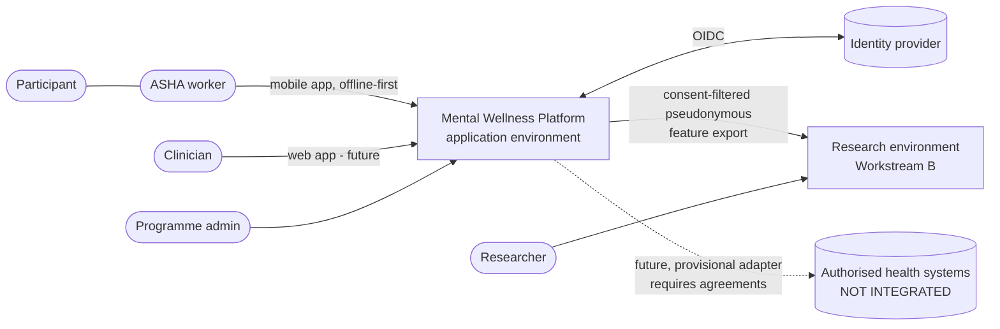
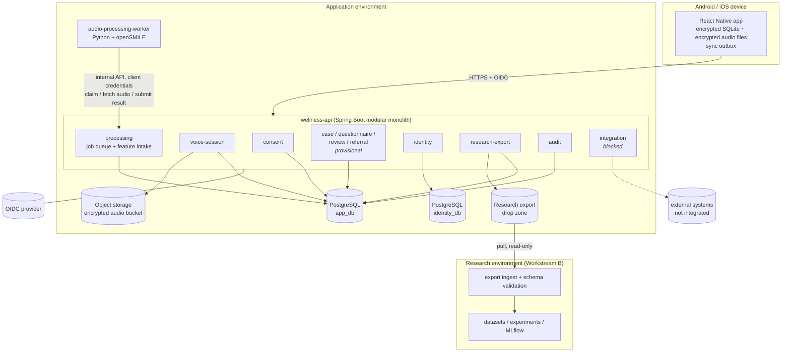

# Solution Architecture

**Version:** 0.1.0
**Date:** 2026-10-17
**Status:** DRAFT — for review by the engineering lead, privacy lead and clinical lead
**Related:** [architecture-decisions.md](architecture-decisions.md), [ADR-001](ADR-001-workstream-separation.md), [consent-and-data-lifecycle.md](../privacy/consent-and-data-lifecycle.md), [vertical-slice-plan.md](../implementation/vertical-slice-plan.md)

---

## 1. Purpose and scope

The platform supports **community mental wellness screening** in two ways:

- ASHA (community health) workers capture consented questionnaires, structured observations and voice recordings, offline if needed.
- Authorised clinicians review cases and manage referrals and follow-up.

A separate research workstream studies acoustic voice features as possible biomarkers.

> **Clinical safety boundary.** This is a screening-support and research platform. It is **not** a diagnostic system. Voice features and any experimental model output never independently diagnose depression, bipolar disorder, dementia or any other condition. Every screening outcome is a decision recorded by a named human clinician. No model output is shown in clinical workflows until it has passed the process in [model-validation-plan.md](../research/model-validation-plan.md).

This document covers the target architecture and the first-slice subset. Anything marked *future* or *provisional* has no confirmed requirements yet.

---

## 2. System context

| Actor / system | Interaction | Status |
|---|---|---|
| **Participant** | Gives consent; answers questionnaires; records voice tasks, usually on the ASHA worker's device | Actor |
| **ASHA worker** | Uses the mobile app offline-first: enrolment, consent, questionnaire, voice capture, sync, follow-up | Actor |
| **Clinician** | Reviews cases, records decisions, creates referrals (web app, future) | Actor |
| **Programme administrator** | Manages users, assignments, consent form versions; handles data-subject requests | Actor |
| **Researcher** | Works only in the research environment on consent-filtered, pseudonymous feature exports. Has no access to the application. | Actor |
| **Identity provider (OIDC)** | Authenticates users and services. Keycloak locally; production IdP **not yet chosen** | Dependency |
| **Hospital / government health systems** | Possible future referral or reporting partners | **Not integrated, not authorised.** Adapter boundary only (§8) |

---

## 3. Logical components

### 3.1 Decomposition decision

Not every domain needs to be a separately deployable service today. The team is small, there is one database engine and one client, the domains are tightly coupled through consent checks, and none of them has its own scaling profile yet. Splitting into eight or more microservices now would add network failure modes, distributed transactions over consent and duplicated infrastructure, with no benefit. (Full rationale: ADR-004 in [architecture-decisions.md](architecture-decisions.md).)

**Recommendation: three application deployables, plus a separate research environment.**

| Deployable | Runtime | Why it is separate |
|---|---|---|
| **wellness-api**: modular monolith | Java 21, Spring Boot | One transactional core for consent, sessions and review. Modules have enforced boundaries (Spring Modulith, ArchUnit) so they can be split out later. |
| **audio-processing-worker** | Python 3.11+, openSMILE | Different language runtime and resource profile (CPU-bound, native binary). Isolated so that it never holds database or storage credentials. |
| **mobile app** | React Native, TypeScript | Client |
| *clinician web app* (future) | TypeScript, React | Client. Not in the first slice. |
| **research environment** (Workstream B) | Python, scikit-learn, MLflow | ADR-001: independently deployable, no write path into the application, never receives raw audio |

### 3.2 Modules inside wellness-api

| Module | Responsibility | Owns data |
|---|---|---|
| `identity` | Stores direct identifiers (name, phone, locality code) against `participant_ref`; audited lookup | **Separate PostgreSQL database** `identity_db` with its own credentials. No other module can query it. |
| `consent` | Consent events, withdrawals, effective-scope calculation, consent form versions; publishes consent-change events in-process | `consent` schema |
| `case` *(provisional)* | Cases, worker assignments | `case` schema |
| `voice-session` | Sessions, recording metadata, audio upload to object storage | `voice` schema + audio bucket |
| `processing` | Job queue (PostgreSQL table), worker leases, feature-record intake and validation | `processing` schema (jobs, feature records as `jsonb`) |
| `questionnaire` / `observation` *(provisional)* | Structured responses | `screening` schema |
| `screening-review` *(provisional)* | Review queue, clinician decisions | `screening` schema |
| `referral` *(provisional)* | Referrals, follow-ups | `referral` schema |
| `research-export` | Builds consent-filtered, pseudonymous feature exports for Workstream B | Read-only over `processing` and `consent` |
| `audit` | Append-only audit events from all modules | `audit` schema (insert-only role) |
| `integration` *(blocked)* | Adapter port for future partner systems | none |

Module rules, enforced by architecture tests:
- A module talks to another only through its published Java API or in-process events. No module reads another module's tables.
- Only `identity` may hold direct identifiers. Every other module uses `participant_ref` (`ppt_…`).
- Every operation on participant data calls `consent.requireScopes(consentEventId, participantRef, scopes)` before doing anything else. Scopes are checked on that consent event, not on the participant's latest event (ADR-011).
- **Assignment in v1:** a `participant_ref` is assigned to the ASHA worker who records its first consent event. Reassignment is an ADMIN operation that will move into the `case` module when it is specified.

### 3.3 Component diagram

---

## 4. Workstream boundaries

| | Application (Workstream A) | Research (Workstream B) |
|---|---|---|
| Owns | mobile app, wellness-api, **audio-processing-worker**, PostgreSQL, audio storage, research export | dataset builds, experiments, evaluation, model registry |
| Sees raw audio | Yes (encrypted storage; worker sees one leased file at a time) | **Never** |
| Sees identity | Only the `identity` module | **Never** |
| Interface | Produces `feature-record.schema.json` v2.0.0 records and export manifests | Consumes them read-only from the drop zone |
| Write path into the other | None | **None** (ADR-001) |

Feature extraction runs **on the application side**. This decision was confirmed on 2026-10-17 and recorded in ADR-006. It follows from [data-governance.md](../privacy/data-governance.md): "only extracted features are transferred". The research side may re-run extraction only on separately authorised research audio datasets (rule 3), never on application audio.

---

## 5. Voice recording → feature processing flow

1. The app checks the local consent record has `SCREENING_PARTICIPATION` + `AUDIO_RECORDING`, and doesn't open the recorder otherwise.
2. The app records 16 kHz mono PCM WAV, computes SHA-256, encrypts the file at rest with a key from the Android Keystore or iOS Keychain, and queues the session in the outbox.
3. On sync it calls `POST /v1/voice-sessions`, then `POST …/recordings` (metadata and checksum), then `PUT …/content` (it decrypts locally and sends over TLS), then `POST /v1/processing-jobs`.
4. `voice-session` re-checks consent, verifies the checksum, stores the audio in the encrypted bucket and emits `RECORDING_CONTENT_STORED`.
5. `processing` inserts a QUEUED job. Processing is **asynchronous** (ADR-007).
6. The worker polls `claim`. The backend re-checks consent, leases the job (`SKIP LOCKED`) and returns a lease plus the consent reference snapshot.
7. The worker fetches the audio, runs server-side QC, then runs openSMILE with the pinned, immutable config, builds a feature record, validates it locally against the schema, and submits it. If QC fails, it calls `failure` instead.
8. The backend validates the record again (schema, job/recording/session match, consent), stores it as `jsonb`, and marks the job SUCCEEDED.
9. The app polls `GET /v1/processing-jobs/{jobId}` and shows the quality outcome. If QC failed, it asks the worker to re-record. **Feature values are never shown in the app.**
10. Later, `research-export` includes the record only if `RESEARCH_FEATURE_REUSE` is still in effect when the export is built.

```mermaid
sequenceDiagram
  autonumber
  participant App as Mobile app
  participant API as wellness-api
  participant C as consent module
  participant S as Object storage
  participant DB as PostgreSQL
  participant W as audio-processing-worker

  App->>API: POST /v1/voice-sessions (session_id, consent_event_id)
  API->>C: requireScopes(SCREENING_PARTICIPATION, AUDIO_RECORDING)
  C-->>API: ok
  API->>DB: insert session
  API-->>App: 201 VoiceSession
  App->>API: POST /recordings (metadata, sha256)
  API-->>App: 201 Recording (upload_path)
  App->>API: PUT /content (audio, X-Content-SHA256)
  API->>C: requireScopes(AUDIO_RECORDING)
  API->>S: put object (server-side encryption)
  API-->>App: 200 STORED
  App->>API: POST /v1/processing-jobs
  API->>DB: insert job QUEUED
  API-->>App: 202 ProcessingJob
  loop poll
    W->>API: POST /internal/v1/processing-jobs/claim
  end
  API->>C: requireScopes(AUDIO_RECORDING)
  API->>DB: lease job (FOR UPDATE SKIP LOCKED)
  API-->>W: 200 JobLease
  W->>API: GET /internal/.../audio (lease token)
  API->>C: requireScopes(AUDIO_RECORDING)
  API->>S: get object
  API-->>W: audio bytes
  W->>W: verify sha256, QC, openSMILE (pinned config), local schema validation
  alt QC pass / degraded
    W->>API: POST /internal/.../result (feature record v2.0.0)
    API->>C: requireScopes(AUDIO_RECORDING)
    API->>DB: validate, overwrite server-known fields, store record, job SUCCEEDED
    API-->>W: 201
  else QC fail or extraction error
    W->>API: POST /internal/.../failure
    API->>DB: job FAILED (or re-queued if retryable)
  end
  App->>API: GET /v1/processing-jobs/{jobId}
  API-->>App: status + quality outcome (no feature values)
```

---

## 6. Offline capture and synchronisation

- **Local store:** SQLite with SQLCipher encryption. Audio files are encrypted with AES-GCM using a key held in the platform keystore and never stored as plaintext. The SQLite store is the source of truth on the device.
- **Client-generated IDs:** every entity created offline (`ce_`, `cw_`, `sess_`, `rec_`, `ppt_`) has a random 128-bit ID, plus an `Idempotency-Key` per request. Retrying after a timeout is always safe.
- **Outbox:** a FIFO list per participant with item states `PENDING → IN_FLIGHT → SYNCED | FAILED`, exponential back-off and a configurable retry limit. Items are never discarded silently; after the limit the worker gets an alert to take action. An entity is uploaded only after the entities it depends on (consent before session, session before recording).
- **Deleting local data:** local audio is deleted only after the server confirms the recording is `STORED` and the checksum matches.
- **Conflict rules** (ADR-008):
  - Consent events and withdrawals are append-only, so they never conflict. **A withdrawal always wins:** a session captured offline after a withdrawal recorded elsewhere is rejected with `CONSENT_NOT_ACTIVE` when it syncs, and its audio is discarded.
  - Sessions and recordings are immutable once submitted, so there are no edits to merge.
  - Mutable records (case details, follow-ups) use optimistic concurrency (`version`). A conflict is shown to a person to resolve and is never auto-merged.
- **Time:** device timestamps are kept as `captured_at_utc`, and server time as `received_at_utc`. Consent checks use the server's consent state at processing time.
- **Lost devices:** tokens are revoked at the IdP and the device's refresh token is invalidated. Local data stays encrypted. A remote-wipe policy is an open question.
- **As built (ADR-017):**
  - The Android app (`workstream-a/mobile/asha-care`) follows this section, with one change: the SQLCipher key is wrapped by the worker's PIN as well as the Keystore.
  - The web app has an optional offline mode with the same outbox rules. It stores everything in IndexedDB encrypted under a PIN-wrapped AES-GCM key, and its service worker caches only the app's own files.
  - Neither client stores tokens.

---

## 7. Clinician review and referral flow *(provisional)*

1. Completed questionnaires and observations create a `ScreeningAssessment` in `AWAITING_REVIEW`. The assessment shows the questionnaire score from the instrument's published scoring rule, and the voice **audio-quality status only**.
2. The clinician reviews and records a decision (`NO_FURTHER_ACTION | MONITOR | REFER | URGENT_REFER`). This is the only screening outcome in the system, and it is attributed to the clinician.
3. `REFER` creates a referral to a programme-configured pathway. Follow-ups are recorded by ASHA workers or clinicians.
4. **Urgent-risk protocol:** for example, a questionnaire item about self-harm triggers immediate escalation in the app with on-screen guidance for the worker. The protocol has to be defined by the clinical lead before any real participant is screened. It is listed as a prerequisite, not designed here.

No model output is part of this flow. Adding one later needs an approved inference contract, model validation and named sign-off (ADR-012).

---

## 8. External health-system integration boundary *(blocked)*

- No external system is integrated, available or authorised. Nothing in the codebase may claim otherwise (rule 7).
- Future shape: an `integration` port inside wellness-api that emits minimal, consented messages to a separately deployed **adapter** per partner, which handles the partner protocol (for example HL7 FHIR). The core platform never takes on a partner's data model.
- Prerequisites: a signed data-sharing agreement, a partner technical specification, a consent scope specific to the partner, legal review and a security assessment.

---

## 9. Deployment view

### 9.1 Local development (Docker Compose)

| Container | Image | Notes |
|---|---|---|
| `postgres` | postgres:16.4 | Two databases, `app_db` and `identity_db`, with separate roles; password (SCRAM) required for every connection |
| `storage` | SeaweedFS 4.47 | S3-compatible audio bucket: default SSE-S3 encryption, 30-day expiry, least-privilege app key, no anonymous access |
| `keycloak` | Keycloak 26.0.5 | Realm `wellness-local`, test users with synthetic names only, `processing-worker` client |
| `wellness-api` | built locally (Java 21) | Port 8080 |
| `audio-processing-worker` | built locally (Python + openSMILE 3.0.x) | No published ports; internal network only |
| `mailpit` *(optional, later)* | — | Only if notifications are added |

The mobile app runs on an emulator against `http://10.0.2.2:8080` (Android). Local environments accept only `data_origin` `SYNTHETIC` or `AUTHORIZED_TEST_AUDIO`.

### 9.2 Future environments

`dev → staging → production`, each with its own database, bucket, IdP realm and keys. Production hosting (cloud provider and region) has not been chosen. Data residency must follow the boundary that legal review defines ([data-governance.md](../privacy/data-governance.md)). The research environment is a separate account or project with no network route to production databases or audio storage. It receives exports through a one-way drop zone.

Kubernetes, Kafka and a service mesh are **not** proposed. A managed container platform (or VMs) running three containers plus managed PostgreSQL and object storage is enough. Revisit if ADR-004's split triggers are met.

---

## 10. Cross-cutting concerns

**Security**
- OIDC: authorization code + PKCE for the mobile app, client credentials for the worker.
- Short-lived access tokens; refresh tokens bound to the device where the platform supports it.
- Role checks plus record-level assignment checks at the module API.
- TLS 1.2+ everywhere. Server-side encryption for the bucket and the database volumes. Envelope keys in a key management service in production.
- Secrets come from the environment or a secret manager, never from the repository; the `check-secrets.sh` hook enforces this.
- Inputs validated against the OpenAPI schemas at the edge. Audio uploads have a size cap and a content-type allow-list.
- Dependency and container image scanning in CI.

**Privacy**
- Identity is held in its own database.
- Pseudonymous IDs are random.
- Feature records contain no identifiers, no audio and no transcript.
- Logs carry IDs only; they contain no request bodies, no audio and no feature values.
- The research export applies the current consent state.

**Observability**
- Structured JSON logs with `correlation_id`, which propagates from the app through the API to the worker.
- Metrics: queue depth, job latency, QC failure rate by language and device class, sync failure rate.
- Traces via OpenTelemetry (local collector optional).
- Audit events are a separate, append-only stream and are not mixed with application logs.

**Reliability**
- Idempotent creates throughout.
- Job leases with expiry and at most 3 attempts.
- The worker is stateless and horizontally scalable.
- The outbox survives app restarts.
- Database backups with point-in-time recovery in production.
- Withdrawal is processed even if the worker is down, because cancellation happens in the database.

**Scalability**
- Expected early load is small: tens of workers, hundreds of sessions a day. One API instance and one or two workers are enough.
- Extraction scales by adding worker replicas. The `SKIP LOCKED` queue supports many workers at this scale.
- Revisit a message broker only if job throughput or fan-out needs exceed what PostgreSQL can handle (ADR-007).

---

## 11. Open questions

| # | Question | Owner |
|---|---|---|
| 1 | Production hosting, region and data-residency boundary | Legal / engineering lead |
| 2 | Production OIDC provider, and how ASHA workers authenticate on shared or low-end devices (PIN, offline token lifetime) | Engineering lead / programme |
| 3 | Questionnaire instruments, licensing and validated Kannada translations | Clinical lead |
| 4 | Urgent-risk escalation protocol | Clinical lead |
| 5 | Raw audio retention period after processing | Privacy / legal |
| 6 | Remote wipe of lost devices | Security / programme |
| 7 | Minimum supported Android API level and target device profile | Programme / mobile lead |
