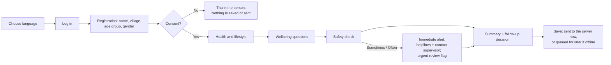

# Business Requirements Document — Community Mental Wellness Platform

| | |
|---|---|
| **Version** | 1.0 (draft for review) |
| **Date** | 2026-10-20 |
| **Status** | Describes the system as built on `main` (commit 38bc30b) and the requirements still open. **Not approved for real participants.** |
| **Audience** | Programme team, clinical lead, privacy and legal reviewers, ethics committee, funders |
| **Related** | [Design and architecture](../architecture/design-and-architecture.md) · [Production infrastructure](../deployment/production-infrastructure-and-deployment.md) · [Consent and data lifecycle](../privacy/consent-and-data-lifecycle.md) · [ADR log](../architecture/architecture-decisions.md) |

**Status labels used in this document**
- ✅ **Built**: implemented and covered by automated tests (synthetic data only).
- 🟡 **Partial**: implemented in part, or as a placeholder awaiting a decision.
- ⛔ **Blocked**: cannot proceed without an external approval or agreement.
- ⬜ **Planned**: agreed but not started.

---

## 1. Purpose

ASHA (Accredited Social Health Activist) workers visit households across India. The programme wants them to be able to:
- hold a short, structured, consented mental-wellbeing conversation during a visit
- make sure anyone at risk reaches a trained person quickly
- connect people to national support programmes such as Tele-MANAS
- report programme activity without exposing anyone's identity

Separately, a research team wants to study, under strict consent, whether acoustic features of the voice could one day help identify people who need support.

This document states what the platform must do to meet those needs, what it does today, and what must happen before real people are involved.

## 2. Background and problem

- Mental-health conditions are common and under-identified in community settings. ASHA workers are trusted and already visit households, but they have no structured, multilingual tool for wellbeing check-ins.
- A disclosure of self-harm thoughts during a visit needs a reliable path to a trained person. Today that depends on informal phone calls.
- Personal health data, and mental-health data in particular, is sensitive under the Digital Personal Data Protection Act 2023 and the Mental Healthcare Act 2017 (s.23, confidentiality). Any tool must be privacy-first by design.
- Voice-based screening is an open research question. Its results are **biomarker candidates, not diagnoses**, and it must never be presented as diagnostic.

## 3. Objectives

| # | Objective | How we'll know (proposed measures, to be agreed with the programme) |
|---|---|---|
| O1 | Give ASHA workers a simple, multilingual, offline-tolerant visit tool | Share of visits completed in the tool; time per visit; sync failure rate |
| O2 | Get every urgent disclosure to a trained person quickly | Median time from urgent flag to clinician review; share reviewed within the agreed target |
| O3 | Close the loop from clinician decision to action | Share of referral decisions with a recorded outcome (partner status or worker follow-up) |
| O4 | Protect participants' privacy and honour consent | Zero identifiers outside the identity store; withdrawals actioned at 100%; audit coverage of every read and write of participant data |
| O5 | Report programme activity without personal data | Monthly aggregate report delivered on time, with small numbers suppressed |
| O6 | Enable ethical voice research | Research receives only consented, re-keyed features; no audio or identity ever leaves the application side |

No targets are set yet. They need the programme team and clinical lead (see §12).

## 4. Scope

**In scope**
- ASHA field app: registration, consent, health and lifestyle questions, an illustrative wellbeing questionnaire, a safety check, a summary and a follow-up decision, in 12 languages.
- Write-only storage of a person's name and village, kept apart from everything else.
- A clinician review dashboard for flagged visits, with coded decisions fed back to the worker.
- Support contacts (helplines) shown at the moment of an urgent disclosure.
- Pseudonymous referrals to partner programmes, and status updates back. Simulated partners only until agreements exist.
- Monthly aggregate reporting for State HMIS / NHM.
- Voice capture, audio quality checks and acoustic feature extraction (openSMILE) on the application side.
- A one-way, consent-filtered, re-keyed research export, and its ingestion by the research pipeline.

**Out of scope for this release**
- Any automated diagnosis, risk score or model prediction shown to anyone.
- Real connections to Tele-MANAS, eSanjeevani, ABDM or HMIS. These are blocked on agreements.
- Assessing people under 18. That needs an approved child pathway.
- Free-text clinical notes. They need a sensitive free-text policy.
- Model training or deployment for clinical use. That needs separate validation and sign-off.
- The native mobile app. It's planned as slice S9; today the field app is a browser test build.

## 5. Stakeholders

| Stakeholder | Interest | Decisions they own |
|---|---|---|
| Programme team (NHM / state programme) | Adoption by ASHA workers, reporting, partner relationships | Enrolment fields, catchments and teams, HMIS format, partner agreements |
| Clinical lead | Safety, validity and referral quality | Questionnaire instruments, urgent-risk protocol, review targets, referral pathways, verified helplines |
| Privacy lead and legal counsel | Lawful, minimal and secure processing | Retention periods, residency, identity fields, contact-detail sharing, DPDP role (fiduciary or processor), breach process |
| Ethics committee | Participant protection | Consent wording and translations, study protocol, research reuse and model training |
| ASHA workers | Simple, fast, respectful visits | Usability feedback |
| Clinicians and counsellors | A clear queue, the right information, no false certainty | Review workflow feedback |
| Research team (Workstream B) | Consented, well-documented data | Dataset and model design within the governance rules |
| Security reviewer | A sound production environment | Production security assessment |

## 6. Users and roles

| Role | Who | Can | Cannot |
|---|---|---|---|
| `ASHA_WORKER` | Field worker | Record consent and withdrawals; open and complete visits; record voice; see their own visits, review decisions and referral status | See other workers' participants; see clinician-only data; read names back |
| `CLINICIAN` | Doctor or counsellor | See the queue of flagged visits; read coded answers; record decisions; send partner referrals | See names or villages; act as a worker; see voice features |
| `ADMIN` | Programme administrator | Reason-coded, audited access to participant records | Access anything without a reason code |
| `PROCESSING_WORKER` | Service | Process queued audio | Anything else |
| `PARTNER_SYSTEM` | Partner service | Report the status of referrals sent to it | See anything else |
| `RESEARCHER` | Research team | Work only in the research environment, on exports | **Any** application access |

## 7. Business processes

### 7.1 Household visit (ASHA worker) — ✅ Built

**Offline (ADR-017), built for synthetic data:**
- The web app has an optional offline mode, which keeps visits encrypted on the device under the worker's PIN.
- The Android app (`workstream-a/mobile/asha-care`) is always offline-first.
- Both keep unsent visits through reloads and restarts, and send each one exactly once after login.

### 7.2 Clinician review — ✅ Built
Flagged visits (an urgent safety answer, or the worker's follow-up request) go to a queue, urgent first. The clinician reads the coded answers, which are marked **not validated**, and records a decision: no further action, monitor, refer, or urgent referral, each with a timeframe. The worker sees the decision in their Follow-ups list and contacts the person.

### 7.3 Partner referral — 🟡 Built, against SIMULATED partners only
After a referral decision, and only if the person agreed to sharing, the clinician sends a pseudonymous referral to a partner programme. The worker connects the person to the programme (a warm handoff), quoting a short handoff code. The partner reports status back, and withdrawing consent revokes the referral at the partner. Real partners are ⛔ blocked on agreements.

### 7.4 Consent withdrawal — ✅ Built
Withdrawal can be partial or complete, and it cascades to dependent permissions. Its effects:
- queued audio processing is cancelled
- retained audio is deleted
- future research exports exclude the person
- partner referrals are revoked

### 7.5 Monthly reporting — 🟡 Built in a neutral format
A person runs the report. It holds counts by age group and gender, with 1–4 shown as `<5`. Mapping to the state's HMIS format is ⛔ blocked on the programme providing that format.

### 7.6 Voice research — ✅ Built (synthetic audio only)
Voice is recorded with consent, quality-checked, and its features extracted on the application side.

Both ASHA apps record voice during the visit only when the person answers yes to the separate audio question (consent form 0.3.0). They record a generated synthetic voice until the privacy lead approves the real microphone. Features reach research only through a human-triggered, consent-filtered, re-keyed export.

## 8. Functional requirements

| ID | Requirement | Status | Where |
|---|---|---|---|
| **Field app** | | | |
| FR-01 | The worker can choose any of 12 languages: English, Telugu, Hindi, Tamil, Bengali, Marathi, Kannada, Malayalam, Gujarati, Punjabi, Urdu, Odia | 🟡 Built. Translations are unreviewed, and untranslated text shows in English, marked "EN". | `asha/` web app, `LanguageTag` |
| FR-02 | The worker logs in with a personal account | ✅ (OIDC + PKCE) | Keycloak client `wellness-asha-web` |
| FR-03 | Collect the person's name or approved identifier and village; never show them again | ✅ Write-only, encrypted | `identity-api.v1.yaml` |
| FR-04 | Collect age group and gender as coded values; refuse under-18s | ✅ | `POST /v1/cases` |
| FR-05 | Record informed consent before any question, with method, read-aloud, understanding, witness and adult confirmation | ✅ | `POST /v1/consent-events` |
| FR-06 | Ask a separate consent question about sharing a referral with partner programmes | ✅ | Scope `EXTERNAL_REFERRAL_SHARING`, form 0.2.0 |
| FR-07 | Record health conditions, tobacco, alcohol and sleep as coded answers | ✅ | `POST /v1/cases/{id}/observations` |
| FR-08 | Ask the wellbeing questions and the safety question; store answers as given, **never scored** | 🟡 Built. The questions are illustrative and **not validated**. | `illustrative-wellness` 0.1.0 |
| FR-09 | On a "sometimes" or "often" safety answer, alert the worker at once and raise an urgent-review flag | 🟡 Built. It's a placeholder: no approved protocol exists yet. | Safety screen; `urgent_review_flag` |
| FR-10 | Show helpline contacts with the urgent alert | 🟡 Built. Tele-MANAS 14416 is shown, pending clinical-lead verification. | `GET /v1/programme/support-contacts` |
| FR-11 | Keep working offline and sync later, safely retrying | 🟡 Built in page memory only. The production mobile app needs encrypted device storage. | Outbox in `app.js`; idempotency keys |
| FR-12 | Show the worker their visits, follow-ups, clinician decisions and referral status | ✅ | `GET /v1/cases`, `/referrals` |
| FR-13 | No free-text notes | ✅ Enforced by excluding the field | Policy, lifecycle §5 |
| **Clinician review** | | | |
| FR-20 | Show flagged visits, urgent first | ✅ | `GET /v1/review-queue` |
| FR-21 | Show coded answers, marked not validated, plus observations and history; never names | ✅ | `GET /v1/review-queue/{id}` |
| FR-22 | Record a coded decision and timeframe; keep every decision (append-only) | ✅ | `POST .../reviews` |
| FR-23 | Send a pseudonymous referral to an enabled partner, only with sharing consent | 🟡 SIMULATED partners only | `POST .../referrals` |
| FR-24 | Limit each clinician to their catchment or team | ⬜ Planned. Today every clinician sees every flagged case, with audit. | ADR-014 |
| FR-25 | Alert or escalate when an urgent case isn't reviewed in time | ⬜ Needs review targets from the clinical lead | ADR-014 |
| **Consent and privacy** | | | |
| FR-30 | Seven consent scopes with dependencies | ✅ | ADR-011, ADR-015 |
| FR-31 | Withdraw some or all scopes at any time, with cascading effects | ✅ | `POST .../withdrawals` |
| FR-32 | Delete the identity record when consent is withdrawn | ⬜ Open decision for the privacy lead | ADR-013 |
| FR-33 | Data-subject rights: access, correction, erasure, nominee, grievance | ⬜ Not built. Required by the DPDP Act. | §10 |
| FR-34 | Audit every read and write of participant data, without values | ✅ Append-only audit table | `audit` module |
| **Integration and reporting** | | | |
| FR-40 | Connect to Tele-MANAS, eSanjeevani and ABDM | ⛔ Blocked on agreements and specs | [Partner onboarding](../integration/partner-onboarding.md) |
| FR-41 | Receive partner status updates | ✅ Simulated | `integration-internal.v1.yaml` |
| FR-42 | Produce the monthly aggregate report, with small numbers suppressed | ✅ Neutral format | `run-hmis-report.sh` |
| **Voice and research** | | | |
| FR-50 | Record voice tasks with consent and check quality | ✅ API + worker (the field app has no microphone yet) | Voice sessions, worker |
| FR-51 | Extract eGeMAPS acoustic features on the application side | ✅ openSMILE, for development and evaluation only (licence) | Processing worker |
| FR-52 | Human-triggered, consent-filtered, re-keyed research export | ✅ | `run-export.sh` |
| FR-53 | No automated diagnosis; no model output shown to anyone | ✅ By design and by contract tests | ADR-012 |

## 9. Non-functional requirements

| ID | Area | Requirement | Status |
|---|---|---|---|
| NFR-01 | Privacy | Names and places only in the separate identity database, encrypted at field level, write-only | ✅ |
| NFR-02 | Privacy | Pseudonymous IDs everywhere else; partner-specific keys for partners; re-keyed IDs for research | ✅ |
| NFR-03 | Security | OIDC on every operation; role plus record-level checks; strict browser security (CSP); TLS in every non-local environment | ✅ code / ⬜ production TLS |
| NFR-04 | Reliability | Every create is idempotent, so retries are safe; queues with leases and retries; withdrawal works even if workers are down | ✅ |
| NFR-05 | Availability | Proposed 99.5% monthly during programme hours, to be confirmed | ⬜ |
| NFR-06 | Performance | Proposed p95 < 500 ms for visit API calls on a 3G-class connection; audio up to 25 MB | ⬜ to be measured |
| NFR-07 | Scale | Initially tens to hundreds of workers and hundreds of visits a day; scale out by adding replicas | Design supports it |
| NFR-08 | Accessibility | Simple language, large touch targets, works on low-end phones; right-to-left for Urdu | 🟡 |
| NFR-09 | Localisation | 12 languages, professionally translated and back-translated before real use | 🟡 Unreviewed |
| NFR-10 | Auditability | Append-only audit of who did what and when (pseudonymous); reason codes for admin access | ✅ |
| NFR-11 | Data residency | Data held in India, subject to legal review | ⬜ Hosting not chosen |
| NFR-12 | Retention | Shortest workable periods until legal sets them; no indefinite retention | 🟡 Audio 30-day local default; others open |
| NFR-13 | Observability | Structured logs with correlation IDs and no personal data; metrics; alerts | 🟡 Logs ✅; metrics and alerts ⬜ |
| NFR-14 | Maintainability | Versioned contracts; automated tests: 218 backend, 633 contract, 16 end-to-end | ✅ |

## 10. Regulatory and compliance requirements

This is an engineering view, **not legal advice**. Legal counsel must confirm it.

| Source | Requirement | Platform position |
|---|---|---|
| DPDP Act 2023 / DPDP Rules 2025 | Consent that is specific, informed and withdrawable; notice in English or an Eighth Schedule language; parental consent for children; data-subject rights; breach notification; reasonable security; Significant Data Fiduciary duties | Consent, withdrawal, minimisation, security and child refusal ✅. Data-subject rights, breach process and retention ⬜. Fiduciary role ⛔ (legal). |
| Mental Healthcare Act 2017 s.23 | Confidentiality of mental-health information | Pseudonymous, role-restricted, audited ✅. Clinician visibility is broader than a catchment ⬜. |
| IT Act s.43A / SPDI Rules | Reasonable security for sensitive personal data | Security controls ✅ in code. Production assessment ⬜. |
| CERT-In Directions 2022 | Report incidents within 6 hours; keep logs 180 days; synchronise clocks | ⬜ Production operations (see the infrastructure document) |
| ICMR ethical guidelines (2017) and ICMR AI-in-health guidelines (2023) | Ethics approval; consent for research reuse and model training | Consent scopes ✅. Approvals ⛔. |
| CDSCO medical-device rules | Software that diagnoses may be a medical device | No diagnosis or score ✅. Any future model needs a regulatory assessment. |
| ABDM Health Data Management Policy | Applies if the platform connects to ABDM | ⛔ Not connected |

## 11. Assumptions and constraints

**Assumptions**
- ASHA workers have an Android phone, or a shared device, with intermittent connectivity.
- The programme will provide catchments and teams, reporting formats and partner contacts.
- Early volumes are small: tens of workers.

**Constraints**
- Synthetic data only until the approvals in §12 exist. This is enforced in code.
- No automatic retraining, deployment or referral sending; every such step is a human action (CLAUDE.md rules 5 and 6).
- No pretending to integrate with external systems (rule 7).
- openSMILE is used for development and evaluation only, pending licence confirmation.

## 12. Approvals and dependencies before real participants

| # | Approval or dependency | Owner | Blocks |
|---|---|---|---|
| 1 | Consent model and scopes: privacy and legal review (the engineering approval was given 2026-10-18/20) | Privacy lead + legal | Any real participant data |
| 2 | Consent wording; translations with back-translation; comprehension testing | Ethics committee / programme | Real consent capture |
| 3 | Ethics approval of the study protocol | Ethics committee | Real participants |
| 4 | Legal review: DPDP role, retention, residency, data-subject rights, breach process | Legal counsel | Production launch |
| 5 | Urgent-risk protocol, verified helplines, referral pathways, review targets | Clinical lead | Any real screening |
| 6 | Licensed, validated questionnaire instruments in each language used | Clinical lead | Questionnaires with real data |
| 7 | Data-sharing agreements and specifications per partner | Programme + partners + legal | Real partner connections |
| 8 | Security assessment of the production environment | Security reviewer | Production launch |
| 9 | Hosting, region and residency decision | Legal / engineering lead | Production build-out |
| 10 | Native mobile app with encrypted offline storage (S9) | Engineering | Field rollout |

## 13. Risks

| Risk | Impact | Mitigation |
|---|---|---|
| An urgent disclosure isn't acted on in time | Harm to a participant | On-screen alert and helplines today; review targets, escalation and an approved protocol needed (§12.5) |
| Illustrative questions are mistaken for a validated screen | Wrong clinical decisions | Labelled "not validated" everywhere; synthetic data only; no scores |
| Re-identification from combined data | Privacy harm, legal exposure | Identity isolated and encrypted; coded data; small-number suppression; re-keyed research |
| Partner holds a referral after withdrawal | Consent breach | Automatic revocation (including sends in flight); failed revocations logged and audited for follow-up |
| Translations are inaccurate | Misunderstood consent or questions | Professional translation and back-translation (§12.2) |
| Shared or lost devices | Data exposure | Today, memory-only storage. Planned: encrypted storage, PIN, remote wipe in the mobile app. |

## 14. Glossary

| Term | Meaning |
|---|---|
| **ASHA** | Accredited Social Health Activist, a community health worker |
| **Case / visit** | One assessment visit, holding coded answers only |
| **Consent scope** | One specific permission (for example screening, audio recording or referral sharing) |
| **Handoff code** | 8-character code a worker quotes when connecting a person to a partner programme |
| **Pseudonymous ID** | Random reference (for example `ppt_…`) that stands for a person without naming them |
| **Synthetic data** | Invented test data; the only kind the platform accepts today |
| **Urgent-review flag** | Marker asking for prompt human follow-up; **not** a risk score |
| **Warm handoff** | The worker connects the person to a service directly, rather than the service cold-calling them |
