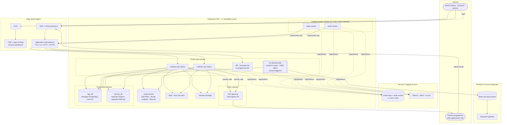
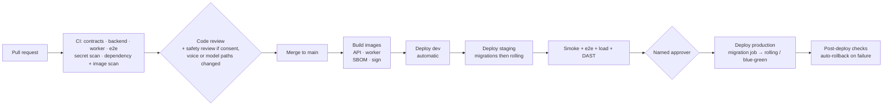

# Production Infrastructure and Deployment Architecture

| | |
|---|---|
| **Version** | 1.0 (proposal for review) |
| **Date** | 2026-10-20 |
| **Status** | **PROPOSED target architecture. Nothing in this document has been provisioned.** Only the local Docker Compose environment (`deploy/local`) exists. Hosting provider, region and residency boundary are open decisions (solution-architecture §11, item 1). |
| **Audience** | Platform and DevOps engineers, security reviewer, engineering lead, legal (for residency) |
| **Related** | [Design and architecture](../architecture/design-and-architecture.md) · [Business requirements](../business/business-requirements.md) · [Consent and data lifecycle](../privacy/consent-and-data-lifecycle.md) · [Partner onboarding](../integration/partner-onboarding.md) |

The application code is designed for this target: it's stateless, configured by environment, and makes no assumptions about orchestration. **But the code is not production-ready yet.** §14 lists the code changes required before go-live, and §16 lists the approvals. No real participant data may enter any environment until §16 is complete; the API enforces this with `wellness.data.allowed-origins`.

---

## 1. Principles

1. **India-resident by default.** Every store, backup, log and replica stays in Indian regions (subject to legal confirmation, BRD §10). Use only MeitY-empanelled cloud services where the programme is government-run; confirm current empanelment at procurement.
2. **Managed services over self-run.** Managed PostgreSQL, object storage, KMS, secrets, load balancer and container runtime. There's nothing to patch at the OS level where it can be avoided.
3. **Separation is structural.** Identity data, research and production each sit behind separate boundaries: a different database instance, a different key, a different account or project.
4. **Least privilege everywhere.** Each workload has one identity with the minimum permissions. There are no shared credentials and no long-lived human access.
5. **Simple first.** A managed container service running two workloads, not Kubernetes, a service mesh or Kafka (ADR-004, ADR-007). Revisit only if the triggers in ADR-004 are met.
6. **Humans gate consequential actions.** Production deploys, database migrations, research exports and HMIS submissions each need a named person's approval (CLAUDE.md rules 5, 6 and 10).
7. **Everything as code.** Infrastructure in Terraform (or the provider's equivalent); pipelines in Git; no manual console changes in staging or production.

## 2. Requirements that drive the infrastructure

| Source | Requirement | Infrastructure response |
|---|---|---|
| DPDP Act / legal review | Personal data stays in the agreed boundary; reasonable security; breach notification | India regions only; encryption everywhere; incident runbook (§12) |
| Mental Healthcare Act s.23 | Confidentiality | Private networking, an isolated identity database, audit retention |
| CERT-In Directions 2022 | Logs kept **180 days** (in India); incidents reported within **6 hours**; clocks synchronised (NTP to NIC/NPL or provider time traceable to them) | Central log store with 1-year retention; on-call and runbook; time sync policy |
| BRD NFR-05/06 | Proposed 99.5% availability; p95 < 500 ms | Two availability zones; at least 2 API replicas; autoscaling |
| BRD NFR-04 | Safe retries; offline tolerance | Stateless API behind a load balancer; idempotency in the database |
| ADR-006/010 | Worker never sees databases; research never sees audio or identity | Worker in an isolated subnet; separate research account with a one-way drop |
| ADR-015 | Partners only after agreements; outbound traffic controlled | Egress via a NAT with fixed IPs and an allow-list; kill switch |

## 3. Environments

| Environment | Purpose | Data | Accounts/projects | Notes |
|---|---|---|---|---|
| `local` | Developer machines | Synthetic | — | `deploy/local` (exists) |
| `dev` | Integration of main-branch builds | Synthetic | `wellness-nonprod` | Auto-deploy from `main`; local web apps may be enabled |
| `staging` | Release candidates, performance and security tests, partner test systems | Synthetic / authorised test audio | `wellness-nonprod` (separate VPC) | Same topology as production at smaller size |
| `production` | Live programme | Participant (**only after §16**) | `wellness-prod` | Manual approval to deploy |
| `research` | Workstream B | Re-keyed exports only | `wellness-research` | **No network route** to production; receives exports through a write-only drop bucket |
| `security/logging` | Central logs, audit archive, security tooling | Logs (no personal data) | `wellness-security` | Write-only from the other accounts |

Each environment has its own databases, bucket, IdP realm or tenant, KMS keys and secrets. Nothing is shared between staging and production.

## 4. Target topology (production)

**About the field app.** The production field client is the native mobile app (S9), which is not built yet. The current `/asha/` browser build is a local test build: it refuses to start in a PARTICIPANT environment and has no encrypted offline storage. Until S9 exists, production has no field client. The clinician dashboard (`/review/`) can be served as static files from the CDN once it's hardened (§14).

## 5. Component specification

The initial sizing below assumes tens to low hundreds of workers and hundreds of visits a day (BRD NFR-07). Review it after staging load tests.

| Component | Managed service (example) | Initial size | High availability | Scaling |
|---|---|---|---|---|
| `wellness-api` | Container service (ECS Fargate / Azure Container Apps / Cloud Run) | 2 tasks × 1 vCPU, 2 GB (JVM `-XX:MaxRAMPercentage=75`) | 2 availability zones; health probes `/actuator/health/{liveness,readiness}` | CPU and request count; 2 → 6 |
| Audio worker | Same platform, internal-only | 1–2 tasks × 2 vCPU, 4 GB | Stateless; leases recover crashed jobs | Queue depth (needs the metric, §8) |
| On-demand jobs | Run-task / Job, using the same API image with `*_RUN_ONCE=true` | Ephemeral | — | Manual trigger only |
| `app_db` | Managed PostgreSQL 16 (RDS / Azure Flexible Server / Cloud SQL) | 2 vCPU, 8 GB, 100 GB gp3, auto-grow | Multi-AZ synchronous standby | Vertical; read replica only if needed |
| `identity_db` | **Separate** managed PostgreSQL 16 instance | 2 vCPU, 4 GB, 20 GB | Multi-AZ | Vertical |
| Audio bucket | Object storage (S3 / Blob / GCS) | — | Provider durability | — |
| Identity provider | Keycloak 26 in **production mode** (HA, 2 nodes, its own managed PostgreSQL), **or** the programme's or state's identity provider if one is mandated | 2 × 1 vCPU, 2 GB | Clustered | — |
| Load balancer + WAF | Provider ALB/Application Gateway + WAF | — | Managed | Managed |
| CDN / static | CloudFront / Front Door / Cloud CDN + private bucket | — | Managed | Managed |
| KMS | Provider KMS (CMKs), HSM-backed where available | — | Managed | — |
| Secrets | Secrets Manager / Key Vault / Secret Manager | — | Managed | — |
| Container registry | Private registry in India region | — | Managed | — |

**Provider mapping (indicative; each needs India-region availability and MeitY empanelment confirmed)**

| Need | AWS (ap-south-1 Mumbai / ap-south-2 Hyderabad) | Azure (Central India / South India) | Google Cloud (asia-south1 Mumbai / asia-south2 Delhi) |
|---|---|---|---|
| Containers | ECS on Fargate | Container Apps | Cloud Run |
| PostgreSQL | RDS for PostgreSQL Multi-AZ | Database for PostgreSQL Flexible Server (zone-redundant) | Cloud SQL for PostgreSQL (HA) |
| Object storage | S3 + SSE-KMS | Blob Storage + CMK | Cloud Storage + CMEK |
| Keys and secrets | KMS, Secrets Manager | Key Vault (Managed HSM) | Cloud KMS, Secret Manager |
| Edge | CloudFront, ALB, WAF, Shield | Front Door, Application Gateway WAF | Cloud CDN, Load Balancing, Cloud Armor |
| Logs and metrics | CloudWatch, OpenSearch | Monitor, Log Analytics | Cloud Logging, Monitoring |

## 6. Network design

| Subnet | Contains | Inbound from | Outbound to |
|---|---|---|---|
| Public | NAT gateway, load balancer nodes | Internet (443 only, via WAF) | API and IdP (443/8080) |
| App (private) | API, IdP, on-demand jobs | Load balancer | Data subnets (5432), object storage private endpoint, KMS, secrets manager, logging; partners **only** via NAT and allow-list |
| Worker (isolated) | Audio workers | — | API's internal endpoint via the internal load balancer only. **No route** to data subnets, the bucket or the internet (image pulls through a registry private endpoint). |
| Data (private) | `app_db`, `identity_db` | App subnet only (`identity_db` only from the API's security group) | — |

- **Database access rules:** the API's security group may reach both databases. The jobs' security group may reach `app_db` only (the research export and HMIS jobs never need identity). The IdP's security group may reach only its own database.
- **Partner egress:** allow-list partner domains and IPs at the NAT or egress firewall. Partners whitelist our fixed NAT IPs. While only simulated partners exist, egress to partners stays closed.
- **Inbound partner events** reach `/internal/v1/partners/**` through the WAF with a path rule. Optionally use mTLS or partner IP allow-lists, as each partner's spec defines.
- **Internal paths:** `/internal/v1/processing-jobs/**` must not be reachable from the internet. Expose it only on an internal load balancer listener.
- **Admin access** goes through a bastion-less session manager with just-in-time approval. There's no SSH, and no public database endpoint.

## 7. Identity, secrets and keys

### 7.1 People and services
- **Users:** OIDC, authorization code + PKCE.
  - MFA required for `CLINICIAN` and `ADMIN`.
  - For `ASHA_WORKER` on shared or low-end devices, a device-bound PIN or offline token policy is still to be decided (solution-architecture §11, item 2).
  - Access tokens last 5 minutes and refresh tokens are rotated.
- **Services:** client credentials (`processing-worker`, one client **per partner**), with secrets in the secrets manager, rotated at least every 90 days.
- **Cloud access:** workload identities (task roles) with least privilege. Human access through SSO with time-limited elevation, every session logged. Break-glass accounts sealed and alarmed.

### 7.2 Application secrets and keys

| Secret | Purpose | Production storage | Rotation |
|---|---|---|---|
| `WELLNESS_DB_PASSWORD`, `WELLNESS_IDENTITY_DB_PASSWORD` | Database roles | Secrets manager (or IAM database auth) | 90 days, automated |
| `WELLNESS_IDENTITY_KEY` | AES-256-GCM field encryption of names and villages | **KMS-wrapped data key** (envelope encryption; code change §14) under a CMK used only for identity | Annual or on suspicion; `key_version` column supports re-encryption |
| `WELLNESS_PSEUDONYM_KEY` | HMAC for `wkr_`/`clin_`/`pk_` | Secrets manager. **Split into three keys** in production (code change §14). | Rarely; pseudonyms change on rotation, so plan a migration |
| `WELLNESS_EXPORT_KEY` | Re-keying research exports | Secrets manager, readable only by the export job | Per export programme (ADR-010) |
| Partner signing secret / mTLS keys | Outbound partner authentication | Secrets manager, one per partner | Per partner spec |
| Storage credentials | Bucket access | **Not needed**: use the workload role, and remove static keys (code change §14) | — |

### 7.3 Encryption
- **In transit:** TLS 1.2+ at the edge. TLS from the API to PostgreSQL (`sslmode=verify-full`) and to object storage.
- **At rest:** each store has its own CMK (`app_db`, `identity_db`, bucket, logs, backups). Identity data is encrypted twice: by the database at rest and at field level by the application.

## 8. Observability

| Signal | Implementation | Status in code |
|---|---|---|
| Logs | ECS JSON to stdout, shipped to the central log store; correlation ID on every line; no personal data | ✅ Emitted. Shipping is ⬜ infrastructure. |
| Audit | `audit.audit_event` in `app_db`; nightly export to an immutable (WORM) archive in the security account, retained ≥ 1 year (legal to confirm) | ✅ Table. Archive ⬜. |
| Metrics | Micrometer → Prometheus or provider metrics | ⬜ **Not exposed today**: only `health` is. Add the `metrics`/`prometheus` endpoints on an internal management port (§14). |
| Traces | OpenTelemetry agent → provider tracing | ⬜ |

**Alerts to define.** Thresholds are proposals for the clinical lead and engineering lead.

| Alert | Why | Proposed threshold |
|---|---|---|
| Urgent case unreviewed | Participant safety | Any `URGENT` item in the queue older than the agreed target (for example 4 h in programme hours). Needs a metric or query job. |
| Revocation failed or stuck | Consent honoured at the partner | Any `REFERRAL_REVOCATION_FAILED` audit event; any `REVOCATION` message `PENDING` > 1 h |
| Outbox backlog | Referrals delayed | `outbound_message` `PENDING` > 50, or oldest > 15 min |
| Processing queue depth / failures | Worker health | `QUEUED` > 100, or `FAILED` rate > 10% / hour |
| QC failure rate by language or device | Data quality | > 30% over 24 h |
| API 5xx / latency | Availability | 5xx > 1% over 5 min; p95 > 1 s |
| Auth failures spike | Attack | > 5× baseline |
| Database health | Capacity | CPU > 80%, storage > 80%, replication lag > 30 s |
| Backup failure; certificate < 21 days to expiry | Recoverability | Any |
| Audit write failures | Integrity | Any |

**Service level objectives (proposed):** 99.5% monthly availability of the visit and review APIs; p95 latency < 500 ms; urgent-case review time per the clinical protocol.

## 9. Backup, disaster recovery and retention

| Item | Proposal |
|---|---|
| PostgreSQL backups | Automated daily snapshots plus point-in-time recovery (35 days `app_db`, 35 days `identity_db`). Encrypted, copied to a second India region. |
| Object storage | Versioning **off** for audio, so deletion on withdrawal is real. Cross-region replication only if legal allows and deletion propagates. |
| RPO / RTO | RPO ≤ 15 min (PITR); RTO ≤ 4 h (restore into the second availability zone or region from infrastructure code) |
| DR drills | Restore test every quarter; documented runbook |
| Backups vs erasure | Deleted data persists in backups until they expire (35 days). Legal must accept this window for withdrawal and erasure. |
| Retention (open, legal) | Audio: ≤ 30-day processing window (bucket lifecycle); feature records, cases, identity, consent: per legal; audit ≥ 12 months; logs ≥ 180 days (CERT-In) |

## 10. Build and deployment pipeline

| Stage | Detail |
|---|---|
| CI | The existing `.github/workflows/ci.yml` jobs (contracts, backend, worker, e2e). Add dependency scanning (OWASP Dependency-Check or Dependabot), container scanning (Trivy), SAST, and IaC scanning (Checkov or tfsec). |
| Images | **API:** a Dockerfile still has to be written (§14). Use a distroless or JRE 21 base with a non-root user, built from `bootJar` or with Spring Boot's buildpacks. **Worker:** the existing `workstream-a/processing-worker/Dockerfile`. Produce an SBOM (Syft), sign with cosign, push to the India-region registry, and pin the digest at deploy. |
| openSMILE licence | The worker image contains openSMILE under the audEERING research licence. **It must not be published publicly or used commercially** without a licence (`contracts/licences/opensmile.md`). Production use needs legal confirmation. |
| Database migrations | Flyway runs as a separate one-shot task before the new version rolls out, under a migration role (the application role gets DML only, after migration). Changes follow **expand → migrate → contract**, so the previous version keeps working during a rolling deploy. Identity migrations run from the API's identity module today; move them into the same pre-deploy job for production (§14). |
| Rollout | Rolling with minimum healthy at 100% and readiness gating, or blue/green behind the load balancer. Automatic rollback on failed health checks or a 5xx surge. |
| Approvals | Production deploy needs a named approver. Changes touching consent, voice recording or model release need the extra safety review (CLAUDE.md rule 10). |
| On-demand jobs | Research export and HMIS report run as approved pipeline jobs (a manual trigger with a recorded approver), never on a schedule (rules 5 and 6). |
| Configuration | Environment variables from the secrets manager and parameter store. Production flags: `WELLNESS_DEV_CONSOLE_ENABLED=false`, `WELLNESS_ASHA_APP_ENABLED=false`, `WELLNESS_REVIEW_APP_ENABLED=false` (the dashboard is served from the CDN instead), and `WELLNESS_PARTNER_SIM_*` unset. `wellness.data.allowed-origins` includes `PARTICIPANT` **only after §16**. |

## 11. Security controls

| Control | Detail |
|---|---|
| WAF | Managed rule sets (OWASP), rate limits per IP and per token (the app itself has **no rate limiting yet**, §14), body size limits (26 MB on audio upload paths only), geo-restriction to India if the programme agrees |
| DDoS | Provider standard or advanced protection on the load balancer and CDN |
| Vulnerability management | Weekly image and dependency scans; critical fixes within 7 days |
| Penetration test | Before go-live and annually; covering OIDC flows, IDOR on every record-level check, partner endpoints, and upload handling |
| Hardening | Containers run as non-root with a read-only root filesystem and no shell where possible; TLS policies restricted to modern ciphers |
| Time sync | All hosts and containers use provider time (NTP), traceable to NIC/NPL as CERT-In requires |
| Data loss prevention | No personal data in logs (enforced in code and tested); alert on log patterns that look like phone numbers or names |
| Security monitoring | Cloud audit trails (control plane), GuardDuty / Defender / Security Command Center, a central SIEM in the security account |

## 12. Incident response and compliance operations

1. **Detect:** alerts (§8) go to on-call (paging, 24×7 for P1).
2. **Report to CERT-In within 6 hours** of noticing a reportable incident, using the CERT-In format. Report to the **Data Protection Board and affected people** as the DPDP Rules require. The legal owner and timelines are to be confirmed (BRD §12, item 4).
3. **Contain:**
   - Partners: the integration kill switch `WELLNESS_INTEGRATION_DISPATCH_ENABLED=false` stops partner sends.
   - People: disable affected IdP accounts and clients.
   - Keys: rotate any affected secrets.
4. **Investigate:** use the correlation IDs across logs and the audit trail (pseudonymous). Preserve evidence in the security account.
5. **Recover and review:** a post-incident review within 10 working days.

The runbooks still to write: data store restore, key rotation, partner revocation backlog, withdrawal processing failure, and IdP outage.

## 13. Capacity and cost notes

- **Expected early load:** fewer than 5 requests per second at peak. Audio uploads are up to 25 MB each, with roughly hundreds a day, so storage is about 10 GB a month before the 30-day expiry.
- **The minimum production footprint:**
  - 2 API tasks
  - 1–2 workers
  - 2 managed PostgreSQL instances (multi-AZ)
  - 2 IdP nodes with their own database
  - load balancer, WAF, CDN, NAT, KMS, logging

  This is a small, predictable monthly cost. Get provider quotes once the region is fixed.
- **Load test in staging** before go-live, at 3× the expected peak, with 10% of traffic being audio uploads.

## 14. Code changes required before production

| # | Change | Why | Effort |
|---|---|---|---|
| 1 | Write the API Dockerfile (non-root, JRE 21) | No API image exists; only `bootJar` | S |
| 2 | Native mobile field app with encrypted offline storage, PIN and remote wipe (S9) | The browser build refuses PARTICIPANT environments and keeps data in memory only | L |
| 3 | Harden the dashboard for CDN hosting: configurable IdP origin in the CSP, production client, no `SIMULATED` wording | It's a local build today | S |
| 4 | Identity key as a KMS-wrapped data key; re-encryption job using `key_version` | No raw key in the environment | M |
| 5 | Split `WELLNESS_PSEUDONYM_KEY` into worker, clinician and partner keys | Limits the blast radius (design doc §13, item 7) | S |
| 6 | Storage access through the workload role (remove the static access key option) | Least privilege, no long-lived keys | S |
| 7 | Database TLS (`sslmode=verify-full`) and IAM database auth, where available | Encryption in transit inside the VPC | S |
| 8 | Expose Micrometer metrics (queue depth, outbox backlog, urgent-unreviewed age, QC rates) on an internal management port | Alerts in §8 depend on it | M |
| 9 | Rate limiting, per token and per IP, using the existing `RATE_LIMITED` problem code | DoS and abuse protection | M |
| 10 | Move identity Flyway into the pre-deploy migration job; a separate migration role | Least privilege at run time | S |
| 11 | Separate identity service (ADR-010 option 3) before real participant data | The intended defence in depth | L |
| 12 | Data-subject rights, identity erasure on withdrawal, retention jobs | DPDP; lifecycle | L |
| 13 | Real partner adapters, a client per partner, per-partner consent (ADR-015 open items) | Before any real partner | M per partner |
| 14 | Graceful shutdown (`server.shutdown=graceful`) and a JVM memory configuration for containers | Clean rolling deploys | S |
| 15 | Keycloak production configuration (HTTPS hostname, production mode, MFA policies) or integration with the mandated IdP | `start-dev` is local only | M |

## 15. Production readiness checklist (go-live)

- [ ] Hosting provider, region and residency approved by legal; empanelment confirmed
- [ ] Infrastructure as code reviewed; staging matches production topology
- [ ] All §14 items done, or formally accepted as risks
- [ ] Penetration test passed; security assessment signed off
- [ ] Alerts and on-call in place; runbooks written; DR restore drill passed
- [ ] Backups verified; retention configured as legal decided
- [ ] CERT-In and DPDP incident procedure owned and tested (tabletop)
- [ ] Load test passed at 3× expected peak
- [ ] `allowed-origins` changed to include `PARTICIPANT` **only** after every item in §16

## 16. Approvals required before participant data

These come from [BRD §12](../business/business-requirements.md#12-approvals-and-dependencies-before-real-participants).

| Approval | From |
|---|---|
| Consent model, wording, translations | Privacy lead, legal, ethics committee |
| Ethics approval of the protocol | Ethics committee |
| Urgent-risk protocol, verified helplines, review targets, validated instruments | Clinical lead |
| DPDP role, retention, residency, breach process | Legal counsel |
| Production security assessment | Security reviewer |
| Each partner connection (agreement, spec, approver) | Programme, partner, legal |
| openSMILE production licence | Legal |
