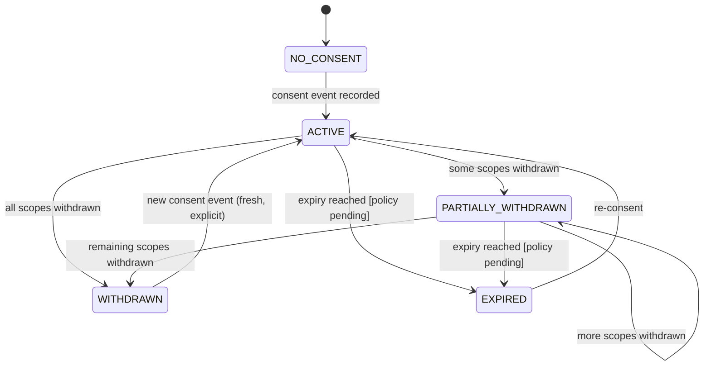

# Consent and Data Lifecycle

**Version:** 0.1.0
**Date:** 2026-10-17
**Status:** APPROVED FOR IMPLEMENTATION WITH SYNTHETIC DATA (responsible engineer, 2026-10-18). Privacy/legal, ethics and clinical review are still required before any real participant data is collected (§14)
**Extends:** [data-governance.md](data-governance.md), which still defines the data categories, access table and audit rules. Where the two differ, this document is the proposed replacement and data-governance.md will be updated once this is approved.
**Related:** [ADR-011](../architecture/architecture-decisions.md#adr-011-authentication-authorisation-and-consent-enforcement), [wellness-api.v1.yaml](../../contracts/openapi/wellness-api.v1.yaml)

> Nothing in this document is legal advice, and none of the open compliance questions are settled. Statements marked **[ASSUMPTION]** need confirmation by the named stakeholder before the platform is used with real participants.

---

## 1. Principles

1. **Informed.** Consent is explained in the participant's language (English or Kannada initially), read aloud where needed, and confirmed as understood. The form version is recorded with every event.
2. **Specific.** Each purpose is a separate scope with an explicit yes or no. There are no pre-ticked boxes and no bundled consent.
3. **Voluntary.** Declining research or recording scopes never affects access to screening or referral.
4. **Revocable.** Any scope can be withdrawn at any time, on any channel, without giving a reason.
5. **Recorded, not assumed.** The server checks for a stored, resolvable consent event before every operation on participant data (rule 9).
6. **Minimal.** Only data needed for a granted scope is collected. Identity is collected only for contact and referral.

---

## 2. Consent scopes

| Scope | What the participant agrees to | Depends on | Data it unlocks |
|---|---|---|---|
| `SCREENING_PARTICIPATION` | Answering screening questions; an ASHA worker recording observations; a clinician reviewing the results and possibly arranging a referral | — | Questionnaire responses, observations, reviews, referrals |
| `AUDIO_RECORDING` | Recording short voice tasks, which are analysed for audio quality and acoustic measurements as part of this programme | `SCREENING_PARTICIPATION` | Raw audio (processing window only), feature records |
| `AUDIO_RETENTION` | Keeping the recording after processing, for the approved retention period | `AUDIO_RECORDING` | Raw audio beyond the processing window |
| `RESEARCH_FEATURE_REUSE` | Sharing pseudonymous acoustic measurements (never the recording, never their name) with the research team | `AUDIO_RECORDING` | Feature records in research exports |
| `MODEL_TRAINING` | Using those measurements to develop experimental computer models (**separate opt-in**) | `RESEARCH_FEATURE_REUSE` | Inclusion in training datasets |
| `QUALITY_REVIEW` | Authorised staff listening to the recording to improve recording quality | `AUDIO_RECORDING`; and `AUDIO_RETENTION`, or the processing window only | Human access to raw audio |

**Rules**
- A consent event records a decision for every scope that its form version offers. The server rejects events with missing decisions.
- Dependent scopes can't be granted without the scopes they depend on, and withdrawal cascades. For example, withdrawing `AUDIO_RECORDING` also withdraws `AUDIO_RETENTION`, `RESEARCH_FEATURE_REUSE`, `MODEL_TRAINING` and `QUALITY_REVIEW`.
- **Mapping from the earlier purposes** in [data-governance.md](data-governance.md):

  | Earlier purpose | New scopes |
  |---|---|
  | `CLINICAL_SUPPORT` | `SCREENING_PARTICIPATION` + `AUDIO_RECORDING` |
  | `RESEARCH_ONLY` | `RESEARCH_FEATURE_REUSE` |
  | `MODEL_TRAINING` | `MODEL_TRAINING` (unchanged) |
  | `QUALITY_REVIEW` | `QUALITY_REVIEW` (unchanged) |

  No data was ever collected under the earlier purposes, so nothing needs migrating.

---

## 3. Consent lifecycle



- Consent events and withdrawals are **append-only and immutable**. Effective scopes are calculated from the full history.
- **Capture:**
  - The capturing worker comes from the access token.
  - The form version and language are recorded.
  - `comprehension_confirmed` must be true.
  - `read_aloud` and `witness_present` are recorded.
  - Capture methods: `SIGNED_ON_DEVICE`, `THUMBPRINT_ON_DEVICE` or `VERBAL_WITNESSED`. **[ASSUMPTION — legal]** All three are acceptable.
- **Offline capture.** Consent can be captured offline and synced later, and local recording is enabled only after the consent event is stored locally. **[ASSUMPTION — legal/ethics]** Offline consent capture is acceptable.
- **Expiry.** `expires_at_utc` stays null until an expiry and re-consent policy is approved. **[ASSUMPTION — ethics]**

---

## 4. Withdrawal and already-derived data

Withdrawal takes effect **immediately for new operations**. Downstream actions run asynchronously and are reported in the API response (`downstream_actions`).

| Withdrawn scope | Immediate effect | Already-derived data |
|---|---|---|
| `AUDIO_RECORDING` | No new sessions, uploads or job claims. Queued jobs are cancelled (`CONSENT_WITHDRAWN`). A worker result in progress is rejected and discarded. | Raw audio is **deleted**. Feature records are **flagged** and excluded from all further use and exports. Whether to delete them or keep them flagged for audit is **[OPEN — privacy/legal]**. Proposed: delete. |
| `AUDIO_RETENTION` | — | Raw audio deleted (it can't be retained past the processing window) |
| `RESEARCH_FEATURE_REUSE` | Excluded from every export built after the withdrawal | Records **already exported** stay in research datasets that are already frozen. They are removed when the dataset is next rebuilt ([data-governance.md](data-governance.md), withdrawal step 4). **[OPEN — ethics]** Whether models already trained on them must be retrained, or only documented. |
| `MODEL_TRAINING` | Excluded from new training datasets | As above |
| `SCREENING_PARTICIPATION` | Cascades to **all** other scopes (everything depends on it), so every effect in the `AUDIO_RECORDING` row also applies. No new questionnaires or observations; the case closes | Clinical records of reviews and referrals already made are kept as clinical records under the applicable retention rules. **[OPEN — legal]** |
| `QUALITY_REVIEW` | No new human listening | — |

Research exports contain only re-keyed pseudonyms (ADR-010), so the application side keeps a mapping per export to build withdrawal lists for Workstream B. Workstream B must apply withdrawal lists before every dataset rebuild. The research pipeline must reject a dataset build if no current withdrawal list has been applied.

---

## 5. Data minimisation, retention and deletion

| Data | Collected when | Retention (proposed) | Deletion |
|---|---|---|---|
| Identity (display name, contact phone, locality code) | Enrolment, only if contact or referral is needed | While the case is open, plus **[OPEN]** | Data-subject request, or case closure plus the retention period |
| Consent events and withdrawals | Always | For as long as any data relying on them exists, plus the audit period | Never edited. Deleted with the case, once everything that depends on it has been deleted. |
| Raw audio | `AUDIO_RECORDING` | **Processing window ≤ 30 days [ASSUMPTION — privacy]**, or the approved period with `AUDIO_RETENTION` | Lifecycle rule plus withdrawal; recorded in the audit log |
| Feature records | `AUDIO_RECORDING` | **[OPEN]** | Withdrawal (see §4) |
| Questionnaires, observations, reviews, referrals | `SCREENING_PARTICIPATION` | Applicable clinical record rules **[OPEN — legal]** | Per legal guidance |
| ASHA case (age band, gender, health conditions, tobacco/alcohol use, sleep, questionnaire answers, follow-up and urgent-review flags) — **sensitive** | `SCREENING_PARTICIPATION`, synthetic data only (ADR-013) | As questionnaires **[OPEN — legal]** | Per legal guidance |
| Identity in the ASHA flow (name or approved identifier, village), encrypted in `identity_db` | After the consent event, write-only (`identity-api.v1.yaml`) | As identity above | As identity above; on withdrawal **[OPEN — privacy]** |
| Audit events | Always | ≥ 12 months **[ASSUMPTION, from data-governance.md]** | Automatic expiry |
| Device-local data | Capture | Until server confirms receipt | Automatic after a confirmed sync; remote wipe **[OPEN]** |

Data that is never collected: precise GPS location, device identifiers (IMEI, advertising ID), transcripts of speech (v1), photos, and free-text clinical notes (until there is a policy on sensitive free text). The ASHA web app therefore leaves out the prototype's "optional notes" field.

The platform must not keep data indefinitely. Until periods are approved, engineering uses the shortest workable period ([data-governance.md](data-governance.md)).

---

## 6. Separation of identity, audio and research data

```
identity_db            app_db (consent, voice, processing, …)       object storage          research environment
───────────            ──────────────────────────────────────       ──────────────          ────────────────────
participant_ref ──┐    participant_ref, consent, sessions,          audio/<rec_id>          re-keyed session IDs,
name, phone,      │    recordings (metadata), jobs,                 (encrypted)             feature records only,
locality code     │    feature records (no identity)                                        no audio, no identity
                  └─ only the identity module can read this mapping
```

- Pseudonymous IDs are 128-bit random values. They are never derived from identifiers.
- Feature records: no identifiers, no audio, no transcript, no prediction (schema-enforced; see [contracts/voice-features/README.md](../../contracts/voice-features/README.md)).
- Research exports re-key **every** identifier (`record_id`, `session_id`, `recording_id`, `processing_job_id`, `consent_event_id`), never include `participant_ref`, truncate timestamps to the date, drop free-text fields such as `degraded_reason`, and leave out worker and locality data (ADR-010).

---

## 7. Encryption

| Where | How |
|---|---|
| Device database | SQLCipher (AES-256), key in Android Keystore / iOS Keychain |
| Device audio files | AES-256-GCM per file, key in the platform keystore; never sent to the server |
| In transit | TLS 1.2+ (TLS 1.3 preferred) for all app ↔ API and API ↔ worker traffic, including on the internal network |
| Object storage | Server-side encryption; KMS-managed keys in production |
| PostgreSQL | Encrypted volumes or storage; `identity_db` additionally uses column encryption for contact phone **[proposed]** |
| Backups | Encrypted; same residency boundary as the source |

Before upload, the device decrypts the audio and streams it over TLS. Device keys never leave the device ([data-governance.md](data-governance.md)).

---

## 8. Roles and access

| Role | Can | Cannot |
|---|---|---|
| `ASHA_WORKER` | Enrol, capture consent, record withdrawals, run screening and capture, see processing status and audio-quality outcome, follow up, all for **assigned participants only** | See feature values, other workers' participants, or research data |
| `CLINICIAN` | Review queue, record decisions, referrals, view consent status, for an assigned catchment | Listen to audio (unless `QUALITY_REVIEW` and a separate role are later approved), see feature values, export data |
| `ADMIN` | User and assignment management, consent form versions, data-subject requests, recording withdrawals on a participant's behalf, reprocessing a recording under a newer pipeline profile | Access participant records without an access-reason code (every access is audited) |
| `RESEARCHER` | Work in the research environment on exports | **Any** application API access |
| `PROCESSING_WORKER` (service) | Claim jobs, fetch leased audio, submit results | Any other API; no database or storage credentials |

Identity lookups (seeing a participant's name or phone) are a separate, audited operation for workers or clinicians who need to make contact. **[OPEN — programme]** Exactly which roles may do this.

---

## 9. Audit logging

- **Events** (see `x-audit-events` in the OpenAPI files) record actor pseudonym, role, action, resource ID, outcome, access-reason code, correlation ID and timestamp.
- **Never logged:** request bodies, names, phone numbers, audio, feature values, questionnaire answers or free text.
- **Storage:** the audit store is append-only. The database role can insert and select but not update or delete. It is reviewed periodically. **[OPEN]** Who reviews it and how often.
- **Identity:** every read of identity data is audited with a reason code (data-governance.md, Category 1).

---

## 10. Secure offline storage and synchronisation

- Everything on the device is encrypted (§7). The app requires a device screen lock, and the app session locks after inactivity.
- Local data is deleted only after the server confirms receipt and the checksum matches.
- Withdrawals captured offline sync with the **highest priority**, ahead of other outbox items.
- When the server rejects an item for consent reasons, the app deletes the local audio for that item.
- **Lost or stolen device:** the IdP session is revoked and the data stays encrypted at rest. Remote wipe is **[OPEN]**.

---

## 11. Participant rights procedures

| Request | Procedure (proposed) |
|---|---|
| **Access** | Admin raises a data-subject request (`DATA_SUBJECT_REQUEST` reason code). The system compiles the participant's consent history, questionnaire responses, review decisions and referrals. Feature records are summarised by count and date, because raw values aren't meaningful to the participant. Delivered in the participant's language through the programme. |
| **Correction** | Identity and case details can be corrected, with a version history. Consent events are never edited; a new event or withdrawal is recorded instead. Clinical decisions are amended by the clinician with a new review entry. |
| **Deletion** | Treated as full withdrawal (§4), plus deleting identity data once clinical-record retention allows. |
| **Export / portability** | **[OPEN — legal]** Whether this is required, and in what format. |

**Response times:** **[OPEN — legal]**. These depend on applicable law, for example India's Digital Personal Data Protection Act, 2023, and its rules. Its applicability and obligations **must be confirmed by legal counsel**; this document does not determine them.

---

## 12. Minors and participants needing additional safeguards

- **v1 accepts adults only.** The API requires `safeguards.adult_confirmed: true` and rejects anything else.
- Guardian consent, assent procedures, and the age threshold are **[OPEN — legal/ethics]**. Minors stay blocked until they are approved.
- **Assisted consent** (for literacy, visual impairment or cognitive concerns) is recorded with `assisted_consent: true`. Who may assist, and what is needed when capacity is uncertain (relevant if dementia-related screening is ever considered), are **[OPEN — ethics/clinical]**.

---

## 13. Human review and safe referral

- Every screening outcome is a decision by a named clinician. The platform never produces an automated diagnosis or risk label.
- Voice processing results shown to anyone are **audio-quality status only**.
- **An urgent-risk protocol is a prerequisite for screening any real participant.** For example, a questionnaire response indicating self-harm risk must trigger immediate on-screen guidance for the worker and an escalation path. The clinical lead must define it, including local helpline and referral contacts that are verified for the programme area. **No real participant may be screened before it is in place.**
- **What exists today (ADR-013, synthetic only):** in the ASHA web app, a SOMETIMES or OFTEN answer to the self-harm question immediately shows the worker a placeholder alert to seek trained human support and contact their supervisor, without waiting for sync. The server sets `urgent_review_flag` on the case and writes the audit event `URGENT_REVIEW_FLAG_RAISED`. This is a stand-in, not the protocol: it has no verified contacts, no escalation route and no clinician queue.
- Referral pathways are programme configuration. The platform doesn't contact external services (see solution-architecture.md §8).

---

## 14. Approvals required before real participant data or research

| # | Approval | From | Blocks |
|---|---|---|---|
| 1 | This consent model and scopes | Named responsible engineer (**given 2026-10-18**) + privacy/legal reviewer (pending) | Engineer approval: implementing consent in v1 against synthetic data. Privacy/legal approval: any real participant data |
| 2 | Consent form wording, Kannada translation with back-translation, comprehension testing | Ethics committee / programme | Any real consent capture |
| 3 | Institutional ethics committee approval of the screening study protocol | Ethics committee | Any real participant data |
| 4 | Legal review of data protection obligations, data residency, retention periods | Legal counsel | Production launch |
| 5 | Urgent-risk protocol and referral pathways | Clinical lead | Any real screening |
| 6 | Questionnaire instruments licensed and validated in each language used (the current `illustrative-wellness` 0.1.0 is NOT VALIDATED) | Clinical lead | Questionnaire module with any non-synthetic data |
| 6a | Approved translations for the ten languages added in API 1.1 (te, hi, ta, bn, mr, ml, gu, pa, ur, or); today's are unreviewed prototype translations | Ethics committee / programme | Consent capture or screening in those languages |
| 7 | Separate ethics approval for research reuse and model training | Ethics committee | Any research export of participant data |
| 8 | Security assessment of the production environment | Security reviewer | Production launch |

Until approvals 2–5 exist, every environment accepts only `SYNTHETIC` or `AUTHORIZED_TEST_AUDIO` data, and the API enforces this (`DATA_ORIGIN_NOT_PERMITTED`).

## 15. Stakeholder assumptions to confirm

- **Legal:** capture methods (§3); offline consent; DPDP Act applicability and obligations; retention periods; data residency; clinical record retention; portability.
- **Ethics:** expiry and re-consent; handling of models already trained on withdrawn data; guardian and assisted consent; research reuse approval.
- **Clinical:** urgent-risk protocol; instruments; whether clinicians should ever hear audio; referral pathways.
- **Privacy:** 30-day processing window; feature-record deletion vs flagging on withdrawal; column encryption; audit review cadence.
- **Programme:** roles allowed to look up identity; shared-device policy; remote wipe.

---

## Approval

| Role | Name | Decision | Date |
|---|---|---|---|
| Responsible engineer | Repository owner (GitHub: `sarafsripad`) | Approved for implementation and testing with synthetic data only | 2026-10-18 |
| Privacy / legal reviewer | | **Pending.** Required before any real participant data (approvals 2–5 in §14 still apply) | |
